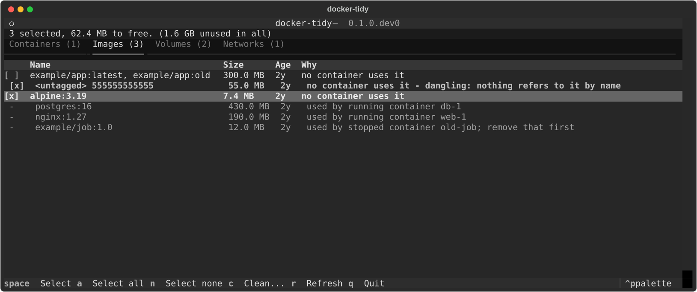
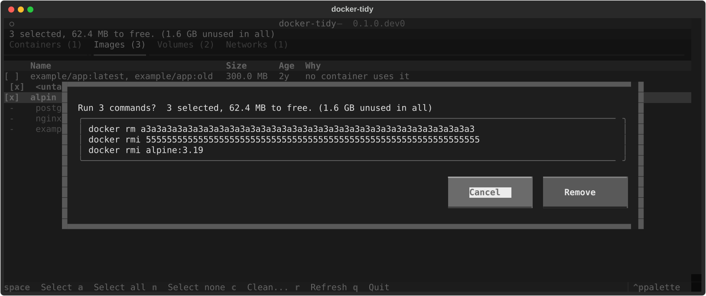

# docker-tidy

See what Docker keeps that nothing uses, and clean it up safely.

docker-tidy lists the stopped containers, images, volumes and networks on a Docker host
that no running service needs, with their sizes, and lets you remove them from a
terminal screen or the command line. It shows the exact `docker` commands before it runs
anything, and it only ever offers what nothing is using.



*The screenshots use an invented host (`tests/scenario.py`). No real Docker data appears
anywhere in this repository.*

## Status

Alpha (`0.1`). The logic is covered by unit tests that read output shaped like docker's,
and the repository has integration tests that run against a real Docker daemon in CI on
Linux. Docker Desktop on macOS, and Podman, are untested. Build cache is not handled yet
(see the [roadmap](#roadmap)).

## Why it is built this way

Cleaning up Docker is a chore people avoid because `docker system prune` is blunt: one
command, a confirmation, and whatever it decides is gone. docker-tidy goes the other
way.

- **It never offers what is in use.** A running container, the image it was created from,
  a volume it mounts and a network it is connected to are all left out, and the reason is
  on screen.
- **Nothing is forced.** It never passes `--force` and never calls `prune`. It removes one
  thing at a time with `docker rm`, `rmi`, `volume rm` and `network rm`, so docker's own
  refusals still apply.
- **You see the commands first.** The confirm dialog and `clean` (without `--yes`) print
  the exact commands.
- **Volumes are handled with care.** Removing one deletes its data, so a volume is never
  ticked for you and the dialog warns about it.
- **It reads the host again before removing.** A resource that was removed or started
  being used since the scan is skipped.

## Install

You need Python 3.11 or newer and the `docker` command, with permission to talk to the
Docker daemon you want to tidy.

From the source (this is the way that works today):

```bash
git clone https://github.com/TrueScaleTech/docker-tidy.git
cd docker-tidy
pip install .
```

or, to keep it out of your other Python packages:

```bash
pipx install git+https://github.com/TrueScaleTech/docker-tidy.git
```

## Quick start

Open the screen:

```bash
docker-tidy
```

Or look first, without changing anything:

```bash
docker-tidy report
```

```text
Containers (1 unused)
  NAME     SIZE    AGE  STATE   WHY
  old-job  2.0 kB  2y   unused  stopped (exited) - image example/job:1.0

Images (3 unused)
  NAME                                 SIZE      AGE  STATE   WHY
  example/app:latest, example/app:old  300.0 MB  2y   unused  no container uses it
  <untagged> 555555555555              55.0 MB   2y   unused  no container uses it - dangling: ...
  alpine:3.19                          7.4 MB    2y   unused  no container uses it
...
Reclaimable: 1.6 GB
```

(The output above is from the invented host in the screenshots.)

Clean up. Without `--yes` it only prints what it would do:

```bash
docker-tidy clean
docker-tidy clean --yes
```

By default `clean` selects stopped containers and untagged images, the same things that
are ticked when the screen opens. Anything else has to be named:

```bash
docker-tidy clean --kind volume                  # every unused volume (dry run)
docker-tidy clean --name alpine:3.19 --yes       # one image, by tag
docker-tidy clean --name orphan-data --yes       # one volume, by name
```

`--name` accepts a name, a tag, a full id, or the first six or more characters of an id.
Asking for something that is in use fails with exit code 2 and removes nothing.

For scripts, `docker-tidy report --json` prints the same information as JSON, and
`--all` includes what is in use and why.

Exit codes: `0` as asked; `1` docker could not be used or a removal failed; `2` the
request was wrong (an unknown name, or something in use).

## The screen

| Key | Does |
|---|---|
| Up / Down | move between rows |
| Left / Right | previous / next tab |
| Space | tick or untick the row (rows in use show `-` and cannot be ticked) |
| `a` | tick every unused row on this tab |
| `n` | untick everything on this tab |
| `c` | show the commands and ask before running them |
| `r` | read Docker again |
| `q` | quit |



In the dialog, focus starts on **Cancel**, so pressing Enter on its own removes nothing.
`y` confirms; Escape cancels.

## How it decides what is unused

| Kind | Offered when | Never offered when |
|---|---|---|
| Container | it has exited, never started, or is dead | it is running, paused, restarting or being removed |
| Image | no container, running **or stopped**, was created from it | any container uses it. An image held only by a stopped container is listed as in use until you remove that container, then it is free on the next scan |
| Volume | no container mounts it | any container, in any state, mounts it |
| Network | no container is connected to it | a container is connected to it, or it is `bridge`, `host`, `none`, `ingress` or `docker_gwbridge` |

Limits worth knowing:

- Containers are matched to images by image **id**, not by name, so a tag that has moved
  does not fool it.
- An image's size is its full size. Layers shared with an image you keep are not freed,
  so "Reclaimable" is an upper estimate for images.
- Volume sizes come from `docker system df -v`, which can be slow on a large host. If it
  is not available the size shows `?`.
- It works on the Docker context your `docker` command is using now (`DOCKER_HOST` and
  `docker context` apply). Check which host you are tidying before you confirm.

## Where your data is

docker-tidy keeps nothing. It writes no files, stores no settings, makes no network
connections of its own and sends no telemetry. It runs the `docker` command and shows you
the result. Because it prints names of your containers, images and volumes, keep that in
mind before pasting its output into a public issue.

## Intended use

Use it on Docker hosts you own or are responsible for. It removes things, and removing a
volume cannot be undone.

## Roadmap

- [ ] Build cache: list it and clean it
- [ ] Filter by age ("unused for more than 30 days")
- [ ] Show an image's unique size, not only its full size
- [ ] Podman
- [ ] Verify on Docker Desktop (Windows and macOS)
- [ ] Publish to PyPI

## Development

```bash
pip install -e ".[dev]"
ruff check .
ruff format --check .
mypy
pytest
```

`pytest` needs no Docker. `pytest -m integration` runs against a real daemon, creating
and removing only resources named `docker-tidy-test-*`. See [CONTRIBUTING.md](CONTRIBUTING.md)
and [SECURITY.md](SECURITY.md). To regenerate the screenshots: `python tools/screenshot.py`.

## License

MIT. See [LICENSE](LICENSE).

Parts of the code and documentation were written with the help of an AI assistant
(Claude). The checks above are what vouch for them.
